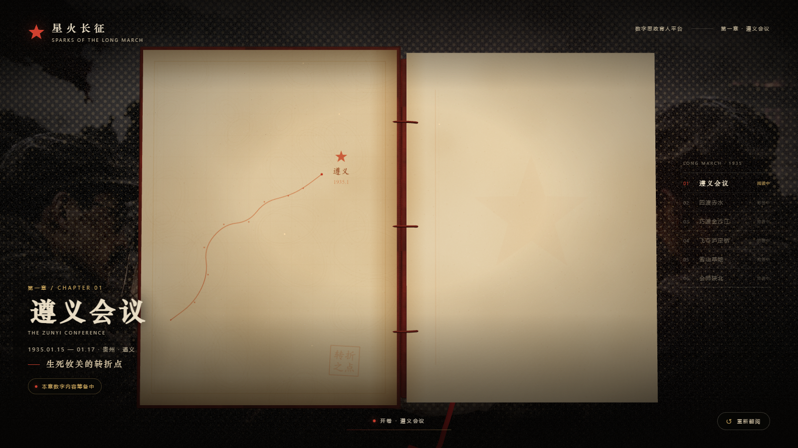
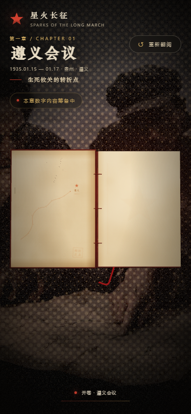
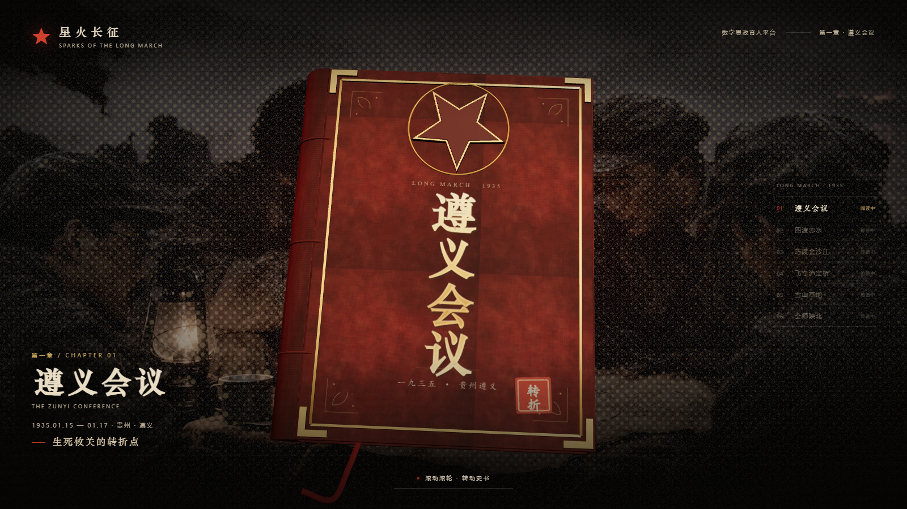
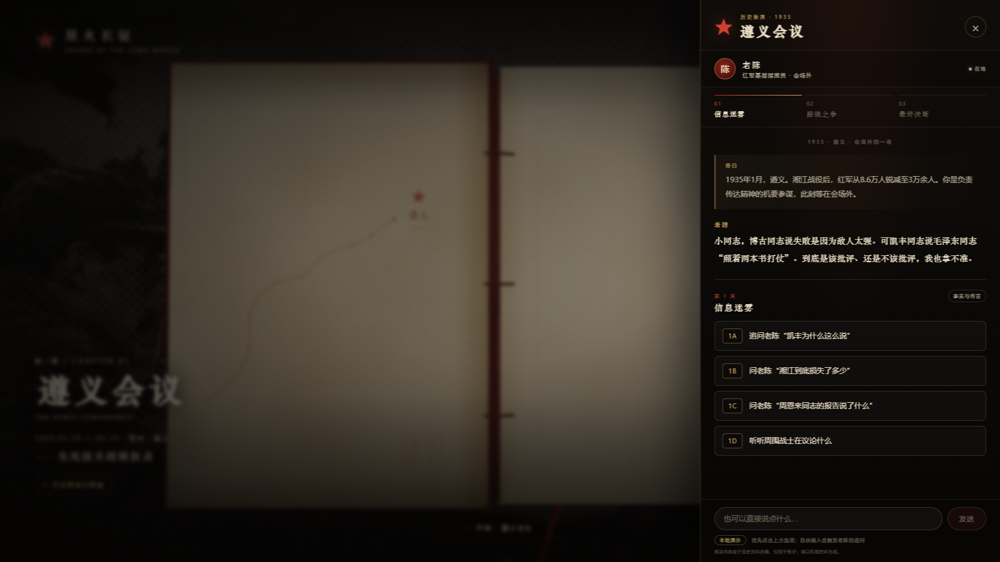
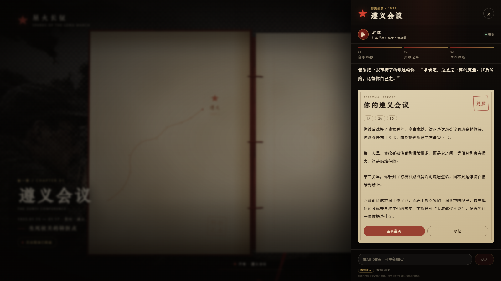
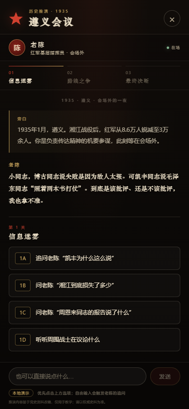

# 星火长征 · 数字思政育人平台

以长征为主题的思政教育平台。当前完成 **第一章：遵义会议** 的前端先导版本，用一本可以旋转、展开的 3D 立体书承载内容；书本内部的正文暂时留空，已接入第一版“历史推演智能体”前端体验（三关单选 + 个性化复盘），可切换真实后端。


## 当前完成度

- [x] 深红布面 3D 精装书：金属包角、黄铜边框、立体五角星、书脊竹节、页块、书签带、做旧纸纹，全部不是简单几何体。
- [x] 滚轮转动书身一整圈（360°），随后书本自动、缓慢展开；支持触屏拖动、键盘方向键、上一页重置。
- [x] 打开后为“左内衬页 + 右空白页”的跨页：左页是一张做旧的长征路线地图，右页留白，标注“历史推演已就绪”。
- [x] 历史推演智能体前端：三关单选、自由输入兜底、个性化复盘报告、错误重试；内置 Mock 可完整演示，也可通过环境变量接入真实 `/api/chat`。
- [x] 智能体后端（FastAPI）按契约实现 `/api/chat`：三关反馈、复盘、模型故障降级，并匿名记录测试行为数据。
- [x] Docker Compose 一键部署：Nginx 托管前端并反向代理 `/api`，FastAPI 后端独立容器。
- [x] 背景循环 8 张遵义/长征电影感画面，采用 Halftone 半调网点 + 做旧棕褐色调 + 指针悬停显影的过渡效果。
- [x] 完整的平台视觉框架：顶部品牌、章节导航、章节信息、进度提示、加载幕、移动端适配。
- [x] 程序化占位材质 + AI 美术资产插槽（封面/封底/布纹/内衬页/纸纹/书口），替换不需要改代码。
- [x] 美术资产提示词包：`docs/ART_ASSET_PROMPTS.md`。

| 打开状态 | 移动端 |
|---|---|
|  |  |



| 历史推演面板 | 复盘报告 |
|---|---|
|  |  |



## 技术栈

- **Vite 8 + React 19 + TypeScript 7**
- **Three.js + @react-three/fiber + @react-three/drei**：真正负责 3D 书本、材质、灯光、相机
- **anime.js 4**：负责 DOM 文字/提示的入场与页面内 2D 动效（它本身不是 3D 引擎）
- **自定义 WebGL2 着色器**：背景半调网点、轮播显影、指针悬停彩色显影
- **Sharp**：把 `photo/` 原图压成网页用 WebP

> 关于 `anime/` 目录：这是你下载并本地构建的 anime.js 源码仓库（v4.5.0）。`web/` 实际通过 npm 使用同版本的 `animejs` 包，源码仓库保留作参考和二次开发。

## 目录结构

```
3dbook/
├─ web/                     # 前端工程（主入口）
│  ├─ src/three/            # 3D：书本、背景着色器、灯光、尘埃
│  ├─ src/components/       # DOM：标题层、加载幕
│  ├─ src/features/agent/   # 历史推演：状态机、Mock/真实接口
│  ├─ public/book/          # 把 AI 美术资产放这里
│  ├─ Dockerfile            # 前端构建 + Nginx 静态站
│  └─ .env.example          # Agent Mock/Live 环境变量样例
├─ server/                  # 智能体后端（FastAPI）
│  ├─ app/                  # 路由、适配层、LLM 调用、匿名测试记录
│  ├─ data/                 # script.json、knowledge.json
│  ├─ Dockerfile
│  └─ .env.example          # DEEPSEEK_API_KEY 等后端配置
├─ tests/                   # 四层测试工程（L1 契约 / L2 生成 / L3 红队 / L4 真人）
├─ 首页/                     # 长征首页子站（构建后进入 web/public/home）
├─ deploy/nginx.conf        # 生产反向代理与入口路由
├─ docs/
│  ├─ ART_ASSET_PROMPTS.md  # 外包美术用的完整提示词包
│  ├─ AGENT_INTEGRATION.md  # 智能体前端对接契约
│  ├─ TEST_DATA_DESIGN.md   # 测试数据设计方案
│  └─ preview/              # 预览截图
├─ docker-compose.yml       # 一键起前端 + 后端
├─ .env.example             # Compose 环境变量模板
└─ README.md
```

> 远端 `前端` 分支只推送前端工程、文档和生成好的背景 WebP；本地 `anime/`（源码参考）与 `photo/`（约 22MB 未压缩原图）不纳入推送。`photo/` 原图只在新增/替换背景、重新运行 `npm run assets:backdrops` 时需要。

## 快速开始

```bash
cd web
npm install
npm run dev
```

打开终端提示的地址（默认 http://localhost:5173）。

生产构建：

```bash
npm run build
npm run preview
```

重新压缩背景图（新增/替换 `photo/` 里的图之后）：

```bash
cd web
npm run assets:backdrops
```

## 启动智能体后端（本地）

```bash
cd server
python -m venv .venv
# Windows
.venv\Scripts\activate
# macOS / Linux
# source .venv/bin/activate
pip install -r requirements.txt
cp .env.example .env          # 填入 DEEPSEEK_API_KEY
uvicorn app.main:app --host 127.0.0.1 --port 8000
```

未配置有效的 `DEEPSEEK_API_KEY` 时进入本地模拟模式，不发起真实模型调用。前端在 `web/.env.local` 设置 `VITE_AGENT_MODE=live` 与 `VITE_AGENT_PROXY_TARGET=http://127.0.0.1:8000` 即可联调。

## Docker 一键部署

```bash
cp .env.example .env          # 根目录，填入 DEEPSEEK_API_KEY
docker compose up -d --build
```

打开 `http://localhost:8080`。

- `web` 容器：构建 `web/` 并由 Nginx 托管，`/api/*` 反向代理到 `api` 服务。
- `api` 容器：FastAPI + Uvicorn，健康检查走 `/api/health`。
- 匿名测试记录使用 SQLite，存放在命名卷 `agent-data`；更新 `script.json` / `knowledge.json` 后如需清空旧数据：`docker compose down -v`。
- 只启动后端：`docker compose up -d --build api`。

## 测试

L1 确定性契约测试不依赖网络和模型：

```bash
cd tests
pip install -r requirements.txt
python -m pytest
```

四层测试的设计、人工评分表与施测材料见 [`tests/测试工作目录.md`](tests/测试工作目录.md) 与 [`docs/TEST_DATA_DESIGN.md`](docs/TEST_DATA_DESIGN.md)。

## 交互说明

1. 页面加载后，书以微倾角度浮在画面中央，指针移动会有轻微视差。
2. 向下滚动滚轮（或触屏上滑），书身绕自身竖轴旋转；累计转过一整圈后，书本自动缓慢展开（约 4.4 秒）。
3. 展开后显示左内衬地图页与右空白页，右页为后续内容预留。
4. 点击右下角“进入历史推演”，进入三关推演面板；也可以直接点“重新翻阅”回到封面。
5. 键盘 `↓ / PageDown / Space` 可前进，`↑ / PageUp` 可回退；触屏上下拖动同样有效。

## 历史推演智能体（已接入前端）

用户扮演负责传达精神的机要参谋，在会场外与红军基层指挥员“老陈”对话：

1. **第一关 · 信息迷雾**：从传言、湘江损失、周恩来报告、战士议论中追问事实。
2. **第二关 · 路线之争**：看懂打法、路线与组织机制的问题。
3. **第三关 · 最终决断**：选择这场会议最重要的精神。
4. 三关结束后输入“复盘”或点击“生成推演复盘”，后端根据 `choice_1 / choice_2 / choice_3` 生成千人千面的报告。

交互入口：开卷后右下角“进入历史推演”。面板为右侧抽屉（移动端全屏），包含老陈头像、关卡进度、旁白、选项卡片、自由输入、复盘报告、错误重试和“重新推演”。

- **默认 Mock 模式**：前端内置了三关演示数据与复盘生成，打开即可完整走通，无需后端。
- **切换真实后端**：复制 `web/.env.example` 为 `web/.env.local`，设置 `VITE_AGENT_MODE=live` 与 `VITE_AGENT_PROXY_TARGET`，后端实现 `POST /api/chat` 即可。
- 接口字段、阶段流转、错误/兜底约定、测试清单见 [`docs/AGENT_INTEGRATION.md`](docs/AGENT_INTEGRATION.md)；产品玩法与 LLM Prompt 的权威来源是仓库根目录的 `遵义会议历史推演智能体 - 核心逻辑与后端对接文档.md`。

## 美术资产外包

`docs/ART_ASSET_PROMPTS.md` 已经写好：

- 统一美术方向、色板、史实与合规要求；
- 封面底图、封底底图、内衬页、纸纹、书口、布纹逐项中英文提示词；
- 负面提示词、尺寸/比例、验收清单；
- 额外背景场景、平台主视觉、后续 3D 道具提示词。

产出的图片放进 `web/public/book/`，然后在 `web/src/config.ts` 的 `BOOK_ASSETS` 里填入 `/book/xxx.webp` 即可。加载失败会自动回退到程序化材质。

> 封面 AI 图请只做**无文字、无星徽、无金属边框**的底纹；金色书名、印章、五角星、边框和包角由 Three.js 叠加，这样中文不会变形，金属件也有真实立体反光。

## 后续扩展（给队友）

### 1. 长征其他章节

- 章节列表在 `web/src/config.ts` 的 `CHAPTERS`，当前只有“遵义会议”是 `active`，其余为 `soon`。
- 下一章可以复用 `Book` 的封面/开合逻辑，替换 `BOOK_ASSETS` 与书页内容；建议后续引入 React Router，把每一章做成独立路由（`/chapter/zunyi`、`/chapter/chishui`…）。
- 书页内容区目前是右侧空白页 + 左侧地图内衬；做内容时可在右侧页面加一层 `Html` / `Text` / 平面贴图，并替换左侧“历史推演已就绪”状态条。

### 2. 智能体后端

- 已实现：`server/` 按契约提供 `POST /api/chat`，三关反馈与复盘走 `script.json` 中的 Prompt，模型故障时静默回退基准文案；匿名测试记录写入 SQLite，便于 L4 数据统计。
- 接口字段、阶段流转、错误/兜底约定、测试清单见 `docs/AGENT_INTEGRATION.md`。
- 部署：根目录 `docker-compose.yml` 一键启动；也可只用 Render 蓝图 `render.yaml` 部署后端。
- 后续可补：流式输出、会话持久化、内容审核、限流与成本控制。

### 3. ReactBits 官方组件

- `web/components.json` 已配置 ReactBits 的 shadcn 注册表，后续要拉官方的 HalftoneReveal、文字动效等组件，可在 `web` 目录运行：
  ```bash
  npx shadcn@latest add @react-bits/HalftoneReveal-TS-CSS
  ```
  （当前背景是独立着色器实现的定制版，官方组件保留给其他页面用。）

### 4. 品牌与文案

- 平台名“星火长征”、章节文案、日期、地点都在 `web/src/config.ts`，改一处即可全站生效。
- 封面书名目前由 Canvas 用系统宋体/华文中宋绘制；如需换成指定书法字体，可在 `web/src/three/textures.ts` 的 `makeCoverArt` 中调整字体栈，或提供透明书名贴图。

## 说明与致谢

- “星火长征”为当前占位品牌名，可按比赛/团队要求替换。
- 背景半调效果的视觉语言参考了 [React Bits – Halftone Reveal](https://www.reactbits.dev/animations/halftone-reveal)（MIT + Commons Clause）；本项目为独立 WebGL 着色器实现，未直接复制其组件源码。
- Three.js、React Three Fiber、drei、anime.js、Vite、React 均遵循各自开源许可。
- `photo/` 里的素材请团队确认版权/授权后使用；AI 生成图请保留生成记录。
